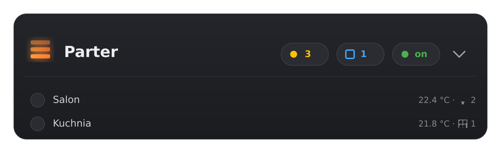

# Stratum




> Dwie customowe karty Home Assistant: **Stratum** (podsumowanie piętra z listą pomieszczeń) + **Stratum Room** (widok pojedynczego pokoju). Jedna konfiguracja, pełna kontrola.

**Stratum** (łac. _warstwa_) — metafora jest dokładna: dom ma warstwy (piętra, strefy), każda warstwa ma swoje pomieszczenia. Karta pokazuje stan warstwy na głównym poziomie (ile świateł, obecność, otwarte okna) i pozwala kliknąć każdy pokój żeby zobaczyć jego detale w popup.

## Dwie karty, jeden bundle

### `stratum-card` (floor card)
Jeden wiersz per pomieszczenie piętra. Header z chipami agregującymi (lights / motion / windows / doors / custom), expandable body z listą pokoi. Klik pokoju → popup z widokiem tego pomieszczenia.

### `stratum-room-card` (room card)
Widok detalu pomieszczenia. Header z chipami specyficznymi dla pokoju, sekcje auto-wykryte (lub ręcznie skonfigurowane): Podsumowanie, Światła, Rolety, Okna, Drzwi, Klimat, Media, Wentylacja, Sceny, **Dowolna karta custom z HACS**.

## Funkcje

### Floor card
- Automatyczna detekcja pomieszczeń z `hass.floors` (HA 2024.3+)
- **Merge rooms** — łączenie pokoi (Kuchnia+Spiżarnia → jeden wiersz z zagregowanymi licznikami)
- **Zwijanie** — rozwinięta karta wraca do stanu z `expanded`, gdy wychodzisz
  z widoku albo aplikacja schodzi do tła. Opcjonalnie `auto_collapse: N` zwija
  ją po N sekundach bezczynności (domyślnie wyłączone)
- **Klik pokoju otwiera popup** z widokiem tego pomieszczenia (bez potrzeby osobnego dashboardu)
- **Pasek scen** opcjonalny — nad / pod listą pomieszczeń
- Pełna kontrola kolejności + per-room overrides (nazwa, ikona, tap_action, widoki popup)
- **Suwak jasności gestem** — przeciągnięcie po wierszu ściemnia/rozjaśnia
  tylko światła, które świecą, każde proporcjonalnie do własnej jasności
  (zgaszonych nie zapala). Zjechanie do zera gasi; kolejne przeciągnięcie po
  ciemnym wierszu przywraca dokładnie ten zestaw. `row_config.slider_from_off:
  none` — po ciemnym pokoju suwak nic nie robi (domyślnie `all`: zapala
  wszystkie). W dużych pokojach (> 8 świateł) żarówki dostają jedną komendę
  po puszczeniu palca, pasek idzie za palcem na bieżąco.

### Room card (popup)
- **11 typów sekcji**: `summary` / `lights` / `covers` / `windows` / `doors` / `climate` / `media` / `fans` / `switches` / `scenes` / `custom`
- **Tryby wyświetlania** per sekcja, m.in.:
  - `tile` (default) — pełny kafel z toggle
  - `slider` — brightness (lights) / position (covers)
  - `rail` / `tint` (grupy świateł) — kafel z paskiem jasności; strzałki ←/→ z klawiatury
  - `player` (media) — odtwarzacz z okładką i głośnością
  - `ambient` (lights) — tile zmienia kolor i jasność wg encji 🌈
  - `bubble` — duża ikona w kółku (mushroom-style)
  - `chips` — kompaktowy pasek pigułek
  - `icon` — sama ikona
  - **`custom:<any-hacs-card>`** — każda encja w sekcji jako dowolna karta HACS (mushroom, bubble-card, button-card…)

### Sceny
- **35 wbudowanych scen** (`image: stratum:<id>`): 26 zdjęć (jasne / noc /
  usypianie / czytanie / relaks / disco / kinkiety / …) dostarczanych jako
  osobne pliki `sceny-<id>.webp` obok bundla i 9 grafik SVG w bundlu
  (praca / kino / gaming / medytacja / …)
- Własne URL obrazków albo ikony + kolor
- Konfigurowalna pozycja, rozmiar, kolumny, aspect ratio (default 16:9).
  Kolumny: sekcja „Sceny" w popupie (sceny znalezione w pokoju) ma domyślnie
  3 — zmienisz `rooms_scene_columns` albo `columns` sekcji; jawny pasek
  `scenes:` bez `columns` sam dobiera liczbę kolumn
- Tap action override per scena

### Konfiguracja
- **Pełny wizualny edytor** — bez pisania YAML
- Per-pokój: checkbox + override name/icon/tap_action/merge_with
- Per-pokój popup: niezależna lista sekcji + scen
- Per-sekcja: filter encji, kolumny, tryb wyświetlania
- Custom HACS cards w dropdown „Tryb wyświetlania" (auto-enumerate z `window.customCards`)

### Język
- Interfejs idzie za językiem użytkownika HA: polski, dla pozostałych
  języków angielski.

### Dostępność
- Obsługa z klawiatury i czytnika ekranu: widoczny obrys fokusu (kolor
  z `--stratum-focus`), Enter/Spacja na kontrolkach, zwinięta lista poza
  kolejnością Tab, popup jako dialog z nazwą pokoju.
- Animacje wyłączają się przy `prefers-reduced-motion`.

### Stylizacja
- CSS variables (`--stratum-*`) dla kolorów i wymiarów, z fallbackiem do
  zmiennych motywu HA
- Shadow parts (`::part(card)`, `::part(header)`, `::part(popup)` itd. —
  które party są osiągalne skąd, opisuje `docs/styling.md`)
- Kompatybilność z `card-mod`
- Pełna dokumentacja stylizacji w [`docs/styling.md`](docs/styling.md)

## Instalacja przez HACS (custom repository)

1. W Home Assistant otwórz **HACS**
2. Kliknij ⋮ (menu) → **Custom repositories**
3. Wypełnij:
   - Repository: `https://github.com/Pirog87/stratum-card`
   - Type: **Plugin** (NIE „Integration"!)
4. **Add**
5. W HACS wyszukaj **Stratum** → **Download**
6. Zaakceptuj dodanie resource (albo ręcznie: *Settings → Dashboards → Resources* → URL `/hacsfiles/stratum-card/stratum-card.js`, type `JavaScript Module`)
7. Ctrl+Shift+R

HACS pobiera wszystkie pliki releasu do jednego katalogu — także
`stratum-card-editors.js` (edytor wizualny, ładowany dopiero przy „Edytuj")
i zdjęcia scen. Zasobem Lovelace jest tylko `stratum-card.js`.

## Instalacja ręczna (bez HACS)

1. Z [ostatniego releasu](https://github.com/Pirog87/stratum-card/releases/latest)
   pobierz `stratum-card.js` **i** `stratum-card-editors.js` (opcjonalnie
   zdjęcia scen `sceny-*.webp`) i wgraj je **do jednego katalogu**, np.
   `/config/www/`.
2. *Settings → Dashboards → Resources → Add resource*: URL
   `/local/stratum-card.js?v=1`, type `JavaScript Module`. Pliku edytorów
   **nie** dodawaj jako zasobu — karta dociąga go sama, z tego samego
   katalogu.
3. Ctrl+Shift+R.

Bez `stratum-card-editors.js` karta działa normalnie, ale edycja jest tylko
w YAML-u: HA pokaże „Edytor wizualny nie jest obsługiwany", a konsola
przeglądarki jedno ostrzeżenie `Stratum: edytor wizualny niedostępny…`.
Przy aktualizacji podmień oba pliki naraz.

## Przykłady

Konkretne konfiguracje YAML w katalogu [`examples/`](examples/):

- [`parter-basic.yaml`](examples/parter-basic.yaml) — prosty floor z auto-discovery
- [`parter-advanced.yaml`](examples/parter-advanced.yaml) — pełna konfiguracja z merge, sekcjami popup, scenami
- [`sypialnia-room.yaml`](examples/sypialnia-room.yaml) — standalone `stratum-room-card`

## Szybki start

Najprostsza konfiguracja — karta dla parteru:

```yaml
type: custom:stratum-card
floor_id: parter
```

Z konfiguracją scen:

```yaml
type: custom:stratum-card
floor_id: parter
scenes:
  items:
    - entity: scene.jasne
      image: stratum:jasne
    - entity: scene.noc
      image: stratum:noc
    - entity: scene.odpoczynek
      image: stratum:relaks
```

Kliknięcie pokoju otwiera popup z automatycznie wykrytymi sekcjami na bazie encji tej area.

## Dev

```bash
git clone https://github.com/Pirog87/stratum-card.git
cd stratum-card
npm install
npm run build      # jednorazowy
npm run watch      # rebuild on save
```

Pliki wyjściowe: `dist/stratum-card.js` (karta — to jest zasób Lovelace) i `dist/stratum-card-editors.js` (edytory, ładowane na żądanie). Skopiuj **oba** do tego samego katalogu w `/config/www/` swojej instancji HA żeby testować zmiany — razem ze zdjęciami scen (`assets/sceny/<id>.webp` jako `sceny-<id>.webp` w tym samym katalogu), jeśli nie masz instalacji z HACS. Bez pliku edytorów karta działa, ale edytuje się tylko w YAML-u.

Szczegóły dev loopu w [`docs/development.md`](docs/development.md).

## Historia zmian

Pełna lista w [`CHANGELOG.md`](CHANGELOG.md). Highlighty:

- **v1.109** — poprawki z pełnego audytu: poprawność, edytor, telefon,
  dostępność i kontrast
- **v1.108** — natychmiastowa reakcja przełączników na tapnięcie
- **v1.107** — suwak jasności ściemnia tylko włączone światła, proporcjonalnie
- **v1.106** — belka „Smugi" (`header.style: stripes`)
- **v1.12** — zunifikowany system wizualny wszystkich edytorów
- **v1.11** — custom HACS cards w dropdown trybów wyświetlania
- **v1.10** — 24 scene presets (redesign + 10 nowych), 16:9 default
- **v1.9** — bubble + icon + **ambient** (kolor żarówki na tile) modes
- **v1.8** — custom card jako sekcja + fix entity filter
- **v1.7** — chips mode dla sekcji i summary
- **v1.6** — styling guide + fix `tap_action: default`
- **v1.5** — per-room popup configuration w edytorze floor
- **v1.3** — RoomSectionConfig + summary section + slider tile
- **v1.2** — sceny z 14 grafikami
- **v1.1** — popup room-card przy klik wiersza
- **v1.0** — stratum-room-card (drugi card type)

## Architektura

Decyzje projektowe: [`docs/architecture.md`](docs/architecture.md).
Roadmap: [`docs/roadmap.md`](docs/roadmap.md).

## Stylizacja

Trzy warstwy customizacji: YAML config, CSS variables, shadow parts. Pełna lista zmiennych (`--stratum-*`) i gotowe snippety card-mod: [`docs/styling.md`](docs/styling.md).

## Licencja

MIT — patrz [`LICENSE`](LICENSE).
